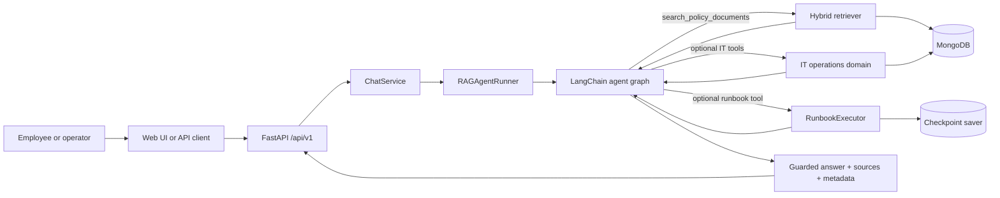
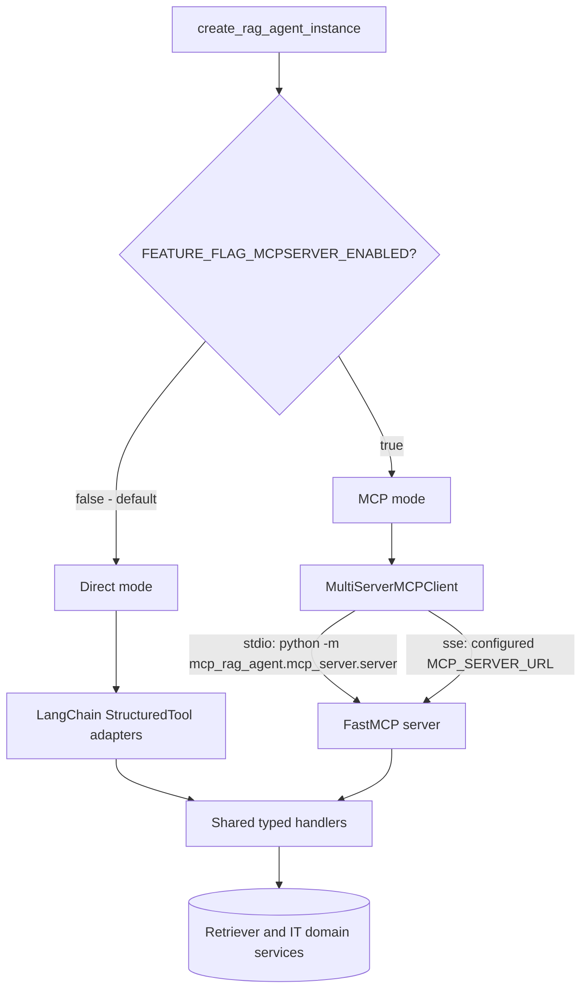
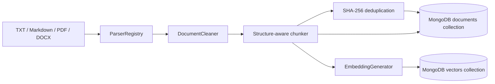
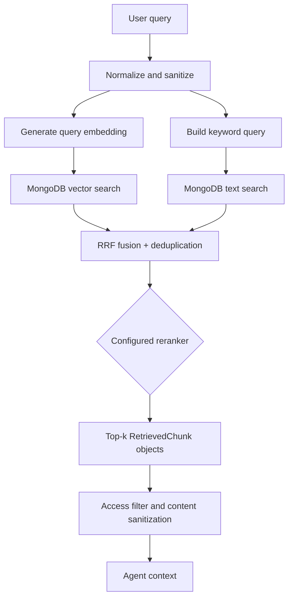
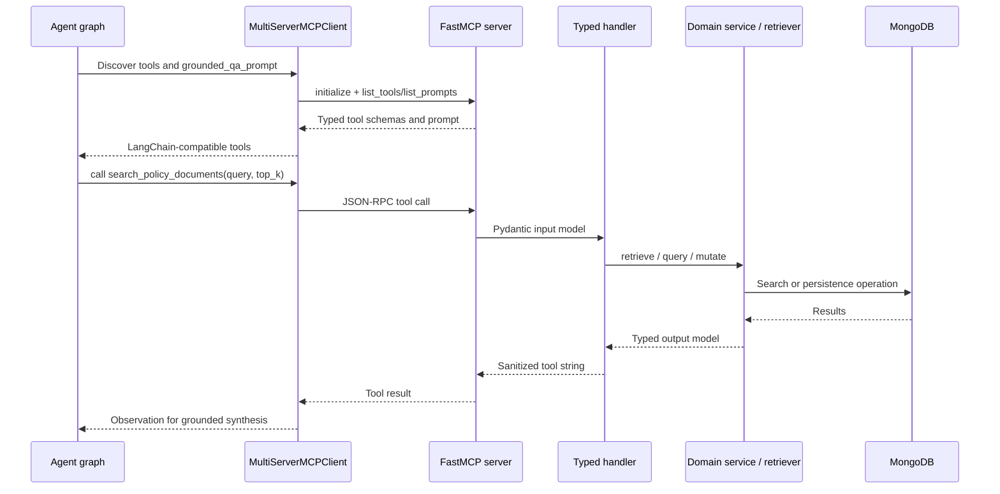
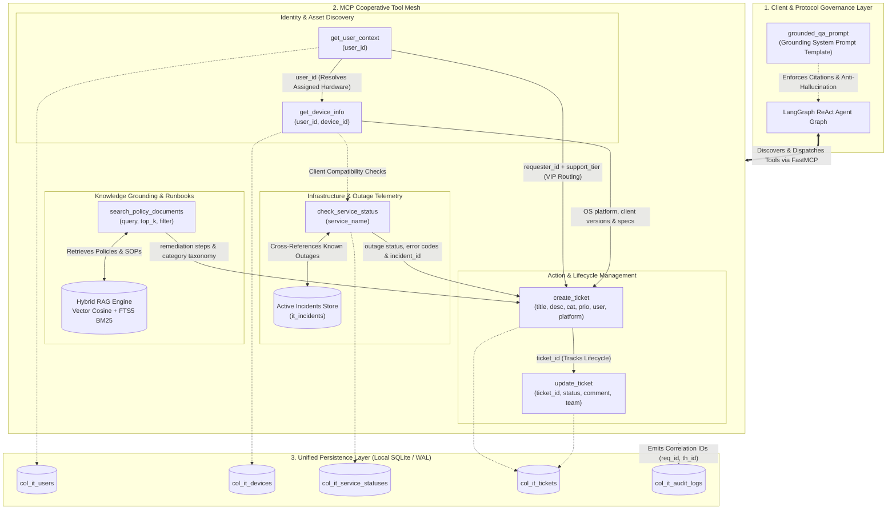
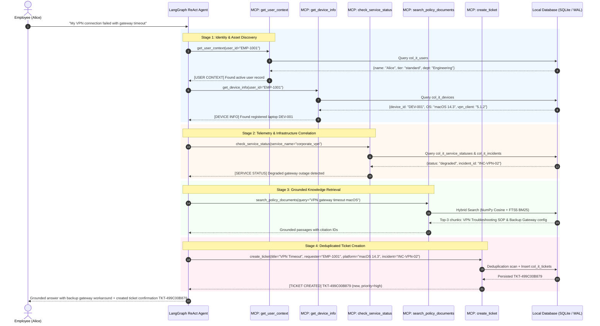
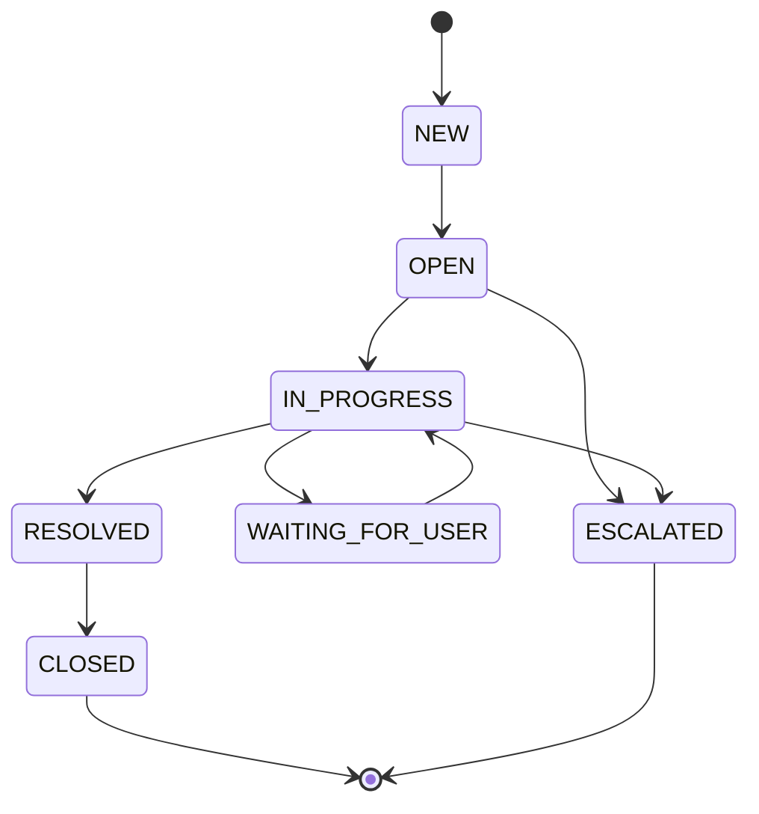
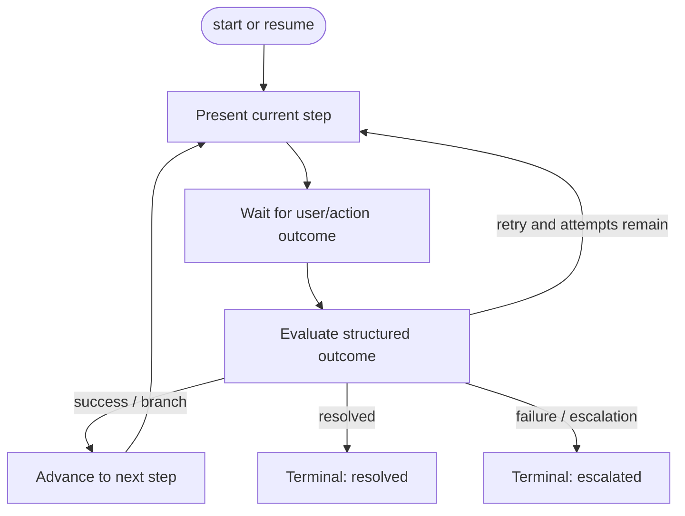

# IT Operations & Support Copilot

> A portfolio-grade enterprise support assistant that combines grounded policy Q&A, hybrid Retrieval-Augmented Generation (RAG), optional MCP-based IT operations, stateful troubleshooting runbooks, ticket workflows, and evaluation tooling.

[](https://www.python.org/)
[](https://fastapi.tiangolo.com/)
[](https://modelcontextprotocol.io/)
[](https://opensource.org/licenses/MIT)
[](.github/workflows/ci.yml)

This README is intentionally implementation-led. It describes the current source tree, runtime paths, feature flags, data contracts, and measured evaluation artifact in this repository. It does not treat design documents or future deployment notes as proof that an integration is active.

## Contents

- [What the project does](#what-the-project-does)
- [Architecture at a glance](#architecture-at-a-glance)
- [The RAG implementation](#the-rag-implementation)
- [The MCP implementation](#the-mcp-implementation)
  - [MCP Interconnection Topology & Multi-Tool Workflow](#mcp-interconnection-topology--multi-tool-workflow)
- [End-to-end request workflow](#end-to-end-request-workflow)
- [IT operations and runbooks](#it-operations-and-runbooks)
- [Security and guardrails](#security-and-guardrails)
- [Evaluation and observability](#evaluation-and-observability)
- [Current project structure](#current-project-structure)
- [Local setup](#local-setup)
- [API surface](#api-surface)
- [Interview-ready design decisions](#interview-ready-design-decisions)
- [Known boundaries](#known-boundaries)

## What the project does

The system is designed for two related support scenarios:

1. **Policy questions** — answer questions about internal policies using retrieved document evidence and source citations.
2. **IT support workflows** — when enabled, expose typed operational tools for users, devices, service health, and tickets, plus deterministic troubleshooting runbooks.

The key design principle is separation of responsibilities:

| Responsibility | Current implementation |
|---|---|
| Natural-language reasoning | LangChain/LangGraph agent created by `create_agent(...)` |
| Knowledge grounding | `AdvancedRetriever` using local vector cosine similarity + SQLite FTS5 BM25 lexical text search (or MongoDB Atlas) |
| Tool boundary | Direct `StructuredTool` adapters or FastMCP tools, selected by a feature flag |
| Deterministic procedures | `RunbookExecutor` and a compiled LangGraph state machine |
| Persistence | Embedded SQLite storage (WAL mode), SQLite FTS5 BM25, NumPy vector engine, and LangGraph `SqliteSaver` (with MongoDB Atlas compatibility) |
| Safety | Input validation, retrieved-content sanitization, access filtering, citation validation, grounding checks, and refusal decisions |
| Evidence of quality | Unit/integration tests plus a versioned 105-case IT benchmark |

## Architecture at a glance


The primary application path is:



Cross-cutting concerns—configuration, correlation IDs, structured logging, secret masking, authorization, audit events, and LangSmith integration—are implemented around these components rather than inside the LLM prompt alone.

### Runtime modes

The same typed tool handlers support two execution modes:



The default configuration is deliberately conservative: MCP mode is off, IT support is off, session memory and guardrails are on, and the default reranker is `none`.

## The RAG implementation

RAG is implemented as a complete ingestion → retrieval → synthesis → verification pipeline, not as a single vector lookup.

### 1. Ingestion and indexing

`DocumentIngestionPipeline` performs the following steps:



- The parser registry supports `.txt`, `.md`, `.pdf`, and `.docx`.
- Text is normalized with Unicode NFKC normalization, control-character removal, whitespace cleanup, and paragraph preservation.
- The default chunk configuration is **500 characters** with **50 characters of overlap**.
- Chunks retain document ID, filename, title, section, page number, source path, chunk index, content hash, and ingestion timestamp.
- SHA-256 hashes make ingestion incremental and allow unchanged documents to be skipped.
- Parent metadata is stored in the configured documents collection; embedded chunks are stored separately in the configured vectors collection.
- `index_documents.py` creates or verifies the vector and text indexes before ingestion.

Relevant source: [`src/mcp_rag_agent/ingestion/`](src/mcp_rag_agent/ingestion/), [`src/mcp_rag_agent/embeddings/index_documents.py`](src/mcp_rag_agent/embeddings/index_documents.py).

### 2. Query preprocessing

`QueryPreprocessor` creates two safe representations of the same user query:

- `semantic_query` — normalized text for embedding generation.
- `keyword_query` — normalized text with unbalanced quotes removed and leading hyphens stripped so MongoDB text syntax is not accidentally abused.

Normalization includes Unicode NFKC conversion, smart-quote normalization, control-character removal, whitespace compaction, and tokenization.

### 3. Parallel hybrid retrieval

`AdvancedRetriever.retrieve(...)` executes the retrieval stages below:



Important implementation details:

- Vector and keyword searches run in parallel.
- Candidate retrieval over-fetches by `retrieval_oversample_factor` (default `3`) before fusion.
- The default semantic weight is `0.7`; keyword weight is `1 - semantic_weight`, therefore `0.3` by default.
- Reciprocal Rank Fusion uses `retrieval_rrf_k=60` by default:

  ```text
  fusion_score(d) = semantic_weight / (60 + vector_rank)
                  + keyword_weight  / (60 + keyword_rank)
  ```

- Results are deduplicated by chunk identity and sorted by fusion score.
- The default `NoOpReranker` preserves the fused ordering. Optional `CrossEncoderReranker` and `LLMReranker` implementations are available behind `RETRIEVAL_RERANKER_TYPE`.
- The default final result is `retrieval_top_k=3` chunks.
- Debug mode records candidate ranks, scores, previews, fusion candidates, final chunks, and per-stage latency without exposing chain-of-thought.

This combination is useful because semantic search handles conceptual similarity while lexical search preserves exact identifiers such as ticket IDs, error codes, product names, and protocol terms. RRF combines rankings without pretending that cosine similarity and text-search scores are calibrated on the same scale.

### 4. Grounded synthesis and provenance

The typed `search_policy_documents` handler returns structured output containing status, chunks, document IDs, fusion scores, ranks, metadata, latency, and an error message when appropriate. `RAGAgentRunner` then:

1. extracts retrieved document IDs and chunks from tool messages;
2. extracts citations from the model's `Reference:` or `References:` section;
3. checks for empty, low-confidence, or error retrieval results;
4. validates that cited documents actually exist in the retrieved set;
5. computes a lexical/numeric grounding score against retrieved context; and
6. replaces unsupported answers with a grounded refusal when necessary.

The four decision categories are:

| Decision | Meaning |
|---|---|
| `SUPPORTED_BY_EVIDENCE` | Retrieved evidence and answer grounding pass validation |
| `INSUFFICIENT_EVIDENCE` | Retrieval is empty/weak or answer grounding is below threshold |
| `OUT_OF_DOMAIN` | Input is outside the policy/IT support scope or contains a blocked injection pattern |
| `SYSTEM_FAILURE` | Agent, retrieval, database, or model execution failed |

The MCP server also exposes `grounded_qa_prompt`, which instructs a connected model to answer only from `search_policy_documents`, cite retrieved documents, and explicitly acknowledge missing information.

## The MCP implementation

### What MCP means in this project

The Model Context Protocol is used as a standardized tool and prompt boundary between the reasoning agent and operational capabilities. The agent does not directly manipulate MongoDB collections or domain models through free-form code. It receives typed tool definitions and calls named capabilities with validated arguments.



### MCP server surface

The FastMCP server in [`src/mcp_rag_agent/mcp_server/server.py`](src/mcp_rag_agent/mcp_server/server.py) registers:

| MCP capability | Purpose | Backing implementation |
|---|---|---|
| `search_policy_documents` | Hybrid policy retrieval | `AdvancedRetriever` |
| `search_documents` | Backward-compatible retrieval alias | Delegates to `search_policy_documents` |
| `get_user_context` | User role, department, tier, account context | User service/store |
| `get_device_info` | Device, OS, client version, compliance data | Device service/store |
| `check_service_status` | Service health and known-incident correlation | `ServiceStatusChecker` |
| `create_ticket` | Create a ticket or return an unresolved duplicate | `TicketService` |
| `update_ticket` | Transition status, assign team, or add a comment | `TicketService` |
| `grounded_qa_prompt` | Server-provided grounding instructions | `@mcp.prompt()` |

The five operational tools are not merely strings in the prompt. Their inputs and outputs are Pydantic models in [`src/mcp_rag_agent/agent/models.py`](src/mcp_rag_agent/agent/models.py), and both direct and MCP modes call the same typed handler functions in [`src/mcp_rag_agent/mcp_server/tools.py`](src/mcp_rag_agent/mcp_server/tools.py).

### MCP transport and lifecycle

- **stdio**: the agent launches `python -m mcp_rag_agent.mcp_server.server` as a subprocess. This is the default transport.
- **SSE**: the agent connects to `MCP_SERVER_URL`, or derives a URL from `MCP_SERVER_HOST` and `MCP_SERVER_PORT`.
- The client discovers tools with `MultiServerMCPClient.get_tools(...)`.
- The client loads `grounded_qa_prompt` once through an MCP session and appends it to the configured system prompt.
- The MCP server uses short-lived sessions for tool discovery/calls through the adapter; domain clients and service instances are lazily cached in the tool module.

### Why the dual-mode design matters

Direct mode is useful for unit tests, local debugging, and environments where a separate process is unnecessary. MCP mode proves that the same capabilities can be exposed through a protocol boundary without rewriting the agent's domain logic. The shared typed handler layer is the parity mechanism: the transport changes, but retrieval, authorization, masking, and domain behavior remain centralized.

### MCP Interconnection Topology & Multi-Tool Workflow

In enterprise IT support, tools are **not isolated silos**. Answering a user query or resolving an infrastructure issue requires chaining identity verification, asset diagnosis, infrastructure telemetry, knowledge base grounding, and transactional ticketing.

The diagram below details how all Model Context Protocol capabilities connect with one another, showing how context, identifiers, and telemetry flow through the agent:



#### Multi-Tool Data Handoff & Interconnection Matrix

The following table summarizes how outputs from upstream MCP tools become inputs and enriched context for downstream tools:

| Source MCP Tool | Connected Target Tool | Shared Context & Payload | Operational Value |
|---|---|---|---|
| `get_user_context` | `get_device_info` | `user_id` | Automatically discovers all assigned laptops, workstations, and mobile devices without requiring the employee to look up serial numbers or asset tags. |
| `get_user_context` | `create_ticket` | `user_id`, `support_tier`, `department` | Populates verified requester identity and automatically routes tickets with elevated priority for VIP personnel or critical business units. |
| `get_device_info` | `check_service_status` | Device OS, Client Agent Version (e.g. `VPN Client 5.1.2`) | Cross-references installed software versions against known service outage bugs or platform compatibility advisories. |
| `get_device_info` | `create_ticket` | `platform` (OS), `product` (hardware model), compliance state | Injects technical environment metadata into the ticket record for Level-2 IT engineering triage. |
| `check_service_status` | `create_ticket` | `service_name`, `error_code`, active `incident_id` | Associates individual user tickets with overarching enterprise incidents (e.g. `INC-VPN-02`), preventing ticket sprawl and enabling bulk resolution. |
| `search_policy_documents` | `create_ticket` | Policy runbook steps, standard resolution SLAs | Categorizes problem domain (e.g. `network`, `access`, `hardware`) and identifies standard operating procedures to attach as initial work notes. |
| `create_ticket` | `update_ticket` | `ticket_id` (e.g. `TKT-499C00B879`) | Manages ticket progression from `new` to `in_progress` to `resolved` as runbook steps are executed or escalated. |

#### Real-World Chained Execution Sequence: End-to-End Troubleshooting

When an employee asks *"My corporate VPN is failing to connect with gateway timeout error"*, the LangGraph agent orchestrates the MCP tools in a structured, multi-turn sequence:



## End-to-end request workflow


For a policy question, the active request path is:

1. `POST /api/v1/chat` reaches `ChatService`.
2. `ChatService` obtains a shared `RAGAgentRunner`.
3. `RAGAgentRunner` creates request/thread correlation context and runs input guardrails.
4. The agent graph decides whether to call `search_policy_documents`.
5. The direct adapter or MCP client invokes the same typed retrieval handler.
6. The handler retrieves, sanitizes, applies subject-aware document filtering when a security subject exists, and returns formatted chunks.
7. The agent synthesizes an answer from the tool result.
8. The runner validates citations and grounding, masks sensitive output, records telemetry, and returns a structured response.
9. `ChatService` deliberately exposes only the final answer, citations, sources, thread ID, request ID, and operational metadata—never tool arguments, internal graph state, or chain-of-thought.

For an IT support request with `FEATURE_FLAG_IT_SUPPORT_ENABLED=true`, the agent also receives five operational tools and `execute_runbook_step`. The runbook tool can start a runbook, evaluate a step, report status, or list available runbooks.

## IT operations and runbooks

### Operational domain

The IT support package contains typed models, stores, services, tools, incidents, service status, tickets, and runbooks. The data stores support MongoDB-backed persistence and in-memory seeded records for local/offline behavior.

The ticket state machine is deterministic:



`TicketService.transition_status(...)` rejects illegal transitions with `InvalidTicketTransitionError`. Ticket creation checks for unresolved duplicates before inserting a new record.

### Runbook engine

The runbook subsystem is separate from free-form LLM reasoning. `RunbookRegistry` selects a matching runbook using deterministic intent rules and tags; `RunbookExecutor` compiles a LangGraph subgraph and persists execution state through a checkpointer.



The allowed step outcomes are `success`, `failure`, `retry`, and `escalate`. Each step has explicit success, failure, escalation, branch, and maximum-retry targets. The LLM can choose when to use the tool and can communicate with the user, but it does not decide arbitrary state transitions.

The registry currently defines ten standard synthetic runbooks:

| Canonical ID | Internal ID | Area |
|---|---|---|
| `RB-NET-VPN-001` | `rb_vpn_troubleshooting` | VPN |
| `RB-NET-WIFI-002` | `rb_wifi_troubleshooting` | Wi-Fi |
| `RB-ACC-MFA-003` | `rb_mfa_troubleshooting` | MFA |
| `RB-ACC-PWD-004` | `rb_password_lockout` | Password/account |
| `RB-ACC-GIT-005` | `rb_github_access` | GitHub access |
| `RB-ACC-JIR-006` | `rb_jira_access` | Jira access |
| `RB-SFT-OUT-007` | `rb_outlook_troubleshooting` | Outlook |
| `RB-HDW-PRN-008` | `rb_printer_troubleshooting` | Printers |
| `RB-HDW-DSP-009` | `rb_laptop_display` | Displays/docks |
| `RB-SEC-PHS-010` | `rb_phishing_incident` | Phishing/security |

## Security and guardrails


### Input and output safety

`RAGGuardrails` implements a four-tier decision taxonomy and coordinates several checks:

- **Input**: removes control characters, detects common prompt-injection/jailbreak patterns, and rejects clearly out-of-domain queries.
- **Retrieved content**: `sanitize_document_text(...)` neutralizes indirect prompt-injection patterns inside retrieved chunks. The retrieval handler wraps the content in a typed result and applies document access filtering when an authenticated subject is present.
- **Output**: validates references against the retrieved document set, computes lexical and numeric overlap with retrieved context, masks credentials/connection strings/emails, and enforces a grounded refusal for insufficient evidence.
- **Context manager**: `RAGGuardrails.filter_context(...)` provides a reusable context-level filter for empty retrieval, confidence thresholds, conflict detection, sandboxing, and context-length truncation.

The active `RAGAgentRunner` path calls `validate_input(...)` and `validate_output(...)`; the retrieval handler performs per-chunk sanitization and access filtering. This distinction matters when explaining which guardrail is active at which layer.

### RBAC and resource scoping

The authoritative RBAC model defines five roles and eighteen permissions:

| Role | Typical scope |
|---|---|
| `EMPLOYEE` | Own tickets/devices/context, knowledge search, service status, ticket creation |
| `IT_SUPPORT` | Broader ticket, user, device, incident, and escalation operations |
| `SECURITY_ANALYST` | Security incidents, high-risk execution, audit visibility |
| `IT_ADMIN` | Ticket/incident/knowledge management, approvals, audit visibility |
| `SYSTEM_ADMIN` | Full operational and approval scope |

Authorization is evaluated at multiple levels:

1. role-to-permission checks;
2. resource checks for tickets, users, and devices; and
3. pre-synthesis document filtering by metadata access level (`public`, `internal`, `confidential`, `security_ops`, `admin_only`).

The API demo boundary obtains a `SecuritySubject` from `X-User-ID`, `X-User-Role`, `X-User-Department`, and `X-User-Support-Tier` headers. Missing headers default to `anonymous_user` with the `employee` role. This is a test/demo identity boundary, not a replacement for a production identity provider.

### Human approval model

`RiskPolicy` classifies actions as low, medium, high, or critical. `ApprovalService` persists approval requests, requires an approver with `APPROVE_HIGH_RISK_ACTION`, enforces requester/approver separation of duties, expires requests after 24 hours by default, and transitions approved requests to `EXECUTED`.

The approval service is implemented and covered by security tests, but the current `create_ticket_typed(...)` and `update_ticket_typed(...)` handlers do not automatically call `request_approval(...)`. Therefore, HITL is a reusable security domain capability in the current checkout, not an implicit gate around every existing MCP ticket operation.

### Audit and secret handling

Tool handlers and audit services redact API keys, bearer tokens, MongoDB connection strings, password assignments, and email addresses before logging or returning diagnostic details. Audit events include request IDs, user IDs, roles, actions, resources, authorization results, statuses, and sanitized details.

## Evaluation and observability

### Measured benchmark artifact

The repository includes a 105-scenario IT benchmark in [`evaluation/datasets/v1_it_support_benchmark.json`](evaluation/datasets/v1_it_support_benchmark.json), supporting evaluation files in [`data/evaluation_documents/`](data/evaluation_documents/), and a recorded result in [`evaluation/results/it_support_run.json`](evaluation/results/it_support_run.json). The result is an offline artifact dated `2026-09-28`, not a claim about every future run.


Selected values from that artifact:

| Metric | Recorded value |
|---|---:|
| Intent accuracy | 83.81% |
| Runbook selection accuracy | 84.38% |
| Runbook completion rate | 80.00% |
| Ticket creation success | 100.00% |
| Unauthorized blocking rate | 100.00% |
| Recall@1 / Recall@3 | 0.9714 / 1.0000 |
| MRR | 1.0000 |
| Faithfulness | 0.9928 |
| Answer relevancy | 0.3438 |
| Answer correctness | 0.3330 |
| Retrieval / generation / total latency | 15.2 / 120.5 / 135.7 ms |

The low recorded answer-relevancy and answer-correctness values are deliberately shown rather than hidden. They are useful signals for discussing benchmark design, offline fixtures, and the difference between retrieval quality and generation quality.

### Observability

`ObservabilityTracer` records:

- request, thread, and optional user IDs;
- retrieval query, retrieved chunk count, document IDs, and latency;
- LLM model latency, input/output/total tokens, and estimated cost;
- tool, retrieval, database, and LLM spans;
- categorized errors (`RETRIEVAL_ERROR`, `MODEL_ERROR`, `MCP_ERROR`, `DATABASE_ERROR`, `VALIDATION_ERROR`, `GUARDRAIL_BLOCK`, `TIMEOUT`); and
- final grounding/citation metadata.

`contextvars` propagates correlation context across async boundaries. Optional LangSmith integration is configured through environment variables.

### Test and quality coverage

The repository currently contains 319 unit-test functions and 10 integration-test functions by static source count. The CI workflows define formatting/import checks, Flake8, a Python 3.10/3.11 unit-test matrix, API tests, Bandit, `pip-audit`, and a scheduled/live MongoDB integration suite. Run the tests locally before making a claim about pass counts for a particular commit.

## Current project structure

The following is the current high-value structure; generated caches and graph-analysis output are omitted from the conceptual tree.

```text
.
├── .github/workflows/
│   ├── ci.yml                         # lint, tests, package/build, security checks
│   └── integration.yml                # scheduled/live MongoDB integration suite
├── data/
│   ├── ingested_documents/            # policy corpus used for indexing
│   └── evaluation_documents/          # benchmark support files
├── docs/
│   ├── assets/                        # architecture, workflow, RAG, security, metric SVGs
│   ├── MCP_IT_OPERATIONS.md           # MCP tool-layer design
│   ├── RBAC_SECURITY_MODEL.md         # roles, permissions, resource isolation, approvals
│   ├── IT_EVALUATION.md               # IT benchmark and metric guide
│   ├── DEPLOYMENT.md                  # deployment notes
│   ├── DEBUGGING_GUIDE.md             # tracing and failure diagnosis
│   ├── PROJECT_STORY.md
│   └── STAR_STORY.md
├── evaluation/
│   ├── datasets/                      # versioned policy and IT benchmarks
│   ├── metrics/                       # retrieval, generation, operational, IT metrics
│   ├── runners/                       # full and regression evaluation runners
│   ├── reports/                       # generated/sample regression reports
│   └── results/                       # recorded JSON/CSV evaluation artifacts
├── scripts/
│   ├── seed_it_operations_data.py
│   ├── benchmark_retrieval.py
│   ├── generate_readme_charts.py
│   └── compare_memory_evaluation.py
├── src/mcp_rag_agent/
│   ├── agent/
│   │   ├── create_agent.py             # async factory; Direct vs MCP mode
│   │   ├── runner.py                   # RAGAgentRunner and response verification
│   │   ├── models.py                   # Pydantic tool/response contracts
│   │   ├── prompts/                    # system and IT-support prompts
│   │   └── utils/                      # direct/MCP agent creators
│   ├── api/
│   │   ├── app.py                      # FastAPI factory and lifecycle
│   │   ├── routes/                     # chat, conversations, health, tickets, admin
│   │   ├── services/                   # API/application services
│   │   ├── schemas/                    # request/response models
│   │   └── static/                     # Vanilla JS/HTML/CSS web UI
│   ├── embeddings/
│   │   ├── embedding_generator.py
│   │   ├── index_documents.py
│   │   ├── hybrid_search.py            # legacy/compatibility hybrid adapter
│   │   └── semantic_search.py
│   ├── ingestion/                      # parsers, cleaning, chunking, pipeline
│   ├── retrieval/                      # preprocessing, AdvancedRetriever, rerankers
│   ├── mcp_server/
│   │   ├── server.py                   # FastMCP tools and grounded prompt
│   │   └── tools.py                    # shared typed handlers and service wiring
│   ├── it_support/
│   │   ├── users/ devices/ services/ incidents/ tickets/
│   │   └── runbooks/                   # registry, graph, executor, definitions, tool
│   ├── security/                       # RBAC, authorization, approvals, audit
│   ├── guardrails/                     # input/context/output grounding controls
│   ├── mongodb/                        # MongoDB client and search/index helpers
│   ├── observability/                  # tracer, context, models, LangSmith bridge
│   └── core/                           # config, logging, checkpointer
├── tests/
│   ├── unit_tests/                     # domain, RAG, guardrail, MCP, API, security tests
│   └── integration_tests/              # MongoDB, MCP, and API integration tests
├── requirements.txt
├── requirements_dev.txt
├── setup.py
├── start.cmd / start.sh
└── .env.example
```

## Local setup

### Prerequisites

- Python 3.10, 3.11, or 3.12
- Local Database: **Self-contained SQLite storage** (zero external database daemon or cloud account required)
- Optional: MongoDB Atlas (if remote cloud database synchronization is explicitly desired)
- OpenAI API key for embeddings and live generation
- Optional: LangSmith credentials for tracing

### Install

```bash
python -m venv .venv

# Windows PowerShell
.\.venv\Scripts\Activate.ps1

# Linux/macOS
# source .venv/bin/activate

python -m pip install --upgrade pip
pip install -r requirements_dev.txt
pip install -e .
```

Copy `.env.example` to `.env`. For local operation, no database URI is needed:

```dotenv
# Local SQLite database path (default: ./data/local_storage.db)
LOCAL_DB_PATH=./data/local_storage.db

# OpenAI API credentials for embeddings and generation
OPENAI_API_KEY=your_key_here
```

### Seed IT Operations Data (Optional)

Populate local SQLite database with initial users, devices, and service statuses:

```bash
python scripts/seed_it_operations_data.py
```

### Database Migration & Backup Tool

Transfer data from MongoDB or export/import local SQLite data:

```bash
# Export local SQLite database to JSON:
python scripts/migrate_to_local_db.py --export-dir ./data/backup_export

# Import JSON records into local SQLite:
python scripts/migrate_to_local_db.py --import-dir ./data/backup_export

# Optional: Migrate directly from live MongoDB into local SQLite:
python scripts/migrate_to_local_db.py --mongo-uri "mongodb://localhost:27017" --mongo-db "mcp_rag_agent_db"
```

### Index policy documents

Run from the repository root so the `src` package resolves correctly:

```bash
python -m mcp_rag_agent.embeddings.index_documents
```

Useful options:

```bash
python -m mcp_rag_agent.embeddings.index_documents --reindex
python -m mcp_rag_agent.embeddings.index_documents --clear
python -m mcp_rag_agent.embeddings.index_documents --folder ./data/ingested_documents --chunk-size 500 --chunk-overlap 50
```

### Start the API and UI

```bash
uvicorn mcp_rag_agent.api.app:create_app --factory --host 127.0.0.1 --port 8000 --reload
```

Open:

- UI: `http://127.0.0.1:8000/ui`
- OpenAPI: `http://127.0.0.1:8000/docs`
- Health: `http://127.0.0.1:8000/api/v1/health`
- Readiness: `http://127.0.0.1:8000/api/v1/ready`

### Enable optional modes

```dotenv
# Connect the agent through FastMCP instead of direct StructuredTools
FEATURE_FLAG_MCPSERVER_ENABLED=true
MCP_TRANSPORT=stdio

# Add IT operations and runbook tools to the agent
FEATURE_FLAG_IT_SUPPORT_ENABLED=true

# Keep safety controls and persistent session memory enabled
FEATURE_FLAG_GUARDRAILS_ENABLED=true
FEATURE_FLAG_SESSION_MEMORY_ENABLED=true
```

Start the standalone server directly when testing MCP itself:

```bash
python -m mcp_rag_agent.mcp_server.server
```

### Test and evaluate

```bash
pytest tests/unit_tests -m "not integration" -v
pytest tests/integration_tests -m integration -v

python -m evaluation.runners.eval_runner \
  --dataset evaluation/datasets/v1_it_support_benchmark.json \
  --output evaluation/results/run_current.json \
  --mode offline
```

For the complete evaluation matrix and regression comparison commands, see [`evaluation/README.md`](evaluation/README.md) and [`docs/IT_EVALUATION.md`](docs/IT_EVALUATION.md).

## API surface

All versioned routes are mounted under `/api/v1`.

| Endpoint | Purpose | Notes |
|---|---|---|
| `POST /chat` | Conversational RAG request | Zero-CoT response contract |
| `POST /conversations` | Create a conversation thread | Persistent when session memory is enabled |
| `GET /conversations` | List tracked threads | UI sidebar support |
| `GET /conversations/{thread_id}` | Read clean dialogue history | Tool traces are omitted |
| `DELETE /conversations/{thread_id}` | Delete thread/checkpoint data | Delegated to `ConversationService` |
| `GET /health` | Liveness probe | Does not require full dependency readiness |
| `GET /ready` | Readiness probe | Checks configured dependencies/runner state |
| `POST /it/tickets` | Create a ticket | Returns 404 while IT support flag is disabled |
| `GET/PATCH /it/tickets/{ticket_id}` | Read or patch a ticket | Lifecycle transitions are validated |
| `GET /admin/tickets` | Admin ticket queue | Requires `IT_ADMIN` or `SYSTEM_ADMIN` |
| `GET /admin/tickets/{ticket_id}` | Admin ticket detail | Admin-only |
| `GET /admin/incidents` | Incident list | Admin-only |
| `GET /admin/metrics` | Operational KPIs | Admin-only |
| `GET /admin/evaluation` | Benchmark summary | Admin-only |
| `GET /admin/audit` | Sanitized audit stream | Requires `VIEW_AUDIT_LOGS` |

Example chat request:

```bash
curl -X POST http://127.0.0.1:8000/api/v1/chat \
  -H "Content-Type: application/json" \
  -d '{
    "message": "How many days of annual leave do employees receive?",
    "thread_id": "demo-thread-001",
    "user_id": "EMP-1001"
  }'
```

## Interview-ready design decisions

### Why hybrid retrieval instead of vector search alone?

Vector search is strong at meaning but can miss exact identifiers. Lexical search is strong at exact terms but can miss paraphrases. The implementation runs both, fuses rankings with RRF, preserves both component scores, and makes reranking pluggable. This improves explainability and avoids adding incomparable raw scores directly.

### Why put retrieval behind MCP?

The MCP boundary standardizes capability discovery and invocation. The agent sees a tool contract; the server owns validation, retrieval, authorization, masking, and database access. This reduces coupling between the reasoning layer and operational backends and allows the same server to be reused by another MCP-capable client.

### Why retain a direct mode?

Direct mode makes unit tests and local development fast and deterministic. It also provides an integration-parity baseline: if direct and MCP modes call the same typed handlers, behavioral differences can be localized to transport/session wiring rather than duplicated business logic.

### What is deterministic and what is probabilistic?

| Probabilistic | Deterministic |
|---|---|
| LLM tool choice and natural-language synthesis | Query normalization and keyword sanitization |
| Embedding similarity | RRF formula and candidate deduplication |
| Optional LLM reranking | Runbook transitions and retry limits |
| LLM-based evaluation metrics when enabled | Ticket lifecycle transitions and duplicate checks |
| | RBAC/resource checks, citation existence checks, refusal rules, and audit sanitization |

This is the central reliability story: use the model for language and planning, but keep state transitions, access decisions, provenance checks, and operational invariants in code.

### How would I explain a failed answer?

Start with `request_id` and `thread_id`, then inspect the trace in order:

```text
API request
  → input guardrail decision
  → agent/model span
  → tool/MCP span
  → retrieval candidates and fusion result
  → retrieved documents and citations
  → grounding score / final decision
  → sanitized API response
```

The structured error taxonomy makes it possible to distinguish retrieval failure, model failure, MCP failure, database failure, guardrail blocking, validation failure, and timeout instead of treating every problem as “the chatbot was wrong.”

## Known boundaries

These points are worth addressing directly in an interview or before calling the repository production-ready:

1. **Feature flags define the default runtime.** `FEATURE_FLAG_MCPSERVER_ENABLED=false` and `FEATURE_FLAG_IT_SUPPORT_ENABLED=false` by default, so a default local run exposes direct policy retrieval rather than the complete MCP/IT-support surface.
2. **The identity boundary is intentionally lightweight.** API roles are derived from request headers and default to an employee subject; a real deployment should place a trusted identity provider and token validation in front of the API.
3. **HITL is a reusable domain service, not an automatic ticket gate today.** Approval models and tests exist, but the current MCP ticket handlers do not call the approval service for ticket creation/update.
4. **The web-search flag is reserved.** `FEATURE_FLAG_WEBSEARCH_ENABLED` exists in configuration, but no active web-search provider is implemented in the current source tree.
5. **Deployment documentation and checkout need reconciliation.** `docs/DEPLOYMENT.md`, `.env.example`, and CI build-validation steps describe Docker Compose/container artifacts, but no Dockerfile or Compose manifest is present in this checkout. Treat container deployment as documentation intent until those artifacts are restored or the workflow is updated.
6. **Offline benchmark metrics have scope.** The recorded 105-case artifact is valuable for regression discussion, but it is not a substitute for a live, representative enterprise corpus and production traffic evaluation.
7. **Retrieval observability has two sources of truth.** The retriever records detailed stage timings and the typed tool returns retrieval latency, while `RAGAgentRunner` currently extracts document IDs/chunks from tool messages and does not parse a latency field from that transcript. Validate latency numbers against the tracer/tool logs when diagnosing a live request.

## Further reading

- [`docs/MCP_IT_OPERATIONS.md`](docs/MCP_IT_OPERATIONS.md) — MCP tool catalog, contracts, and runtime modes
- [`docs/RBAC_SECURITY_MODEL.md`](docs/RBAC_SECURITY_MODEL.md) — RBAC, resource scoping, approvals, and audit design
- [`docs/IT_EVALUATION.md`](docs/IT_EVALUATION.md) — benchmark schema, metrics, and evaluation commands
- [`docs/DEBUGGING_GUIDE.md`](docs/DEBUGGING_GUIDE.md) — request correlation and failure diagnosis
- [`src/mcp_rag_agent/agent/README.md`](src/mcp_rag_agent/agent/README.md) — agent construction and guardrail details
- [`src/mcp_rag_agent/embeddings/README.md`](src/mcp_rag_agent/embeddings/README.md) — embedding and indexing details
- [`src/mcp_rag_agent/mcp_server/README.md`](src/mcp_rag_agent/mcp_server/README.md) — FastMCP module guide
- [`evaluation/README.md`](evaluation/README.md) — evaluation framework and regression reports

## License

This project is released under the MIT License. See [`setup.py`](setup.py) for the package metadata.
